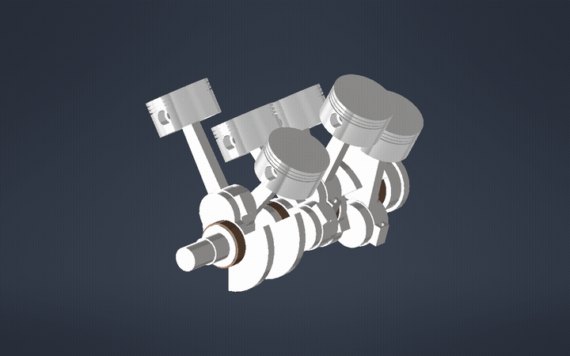
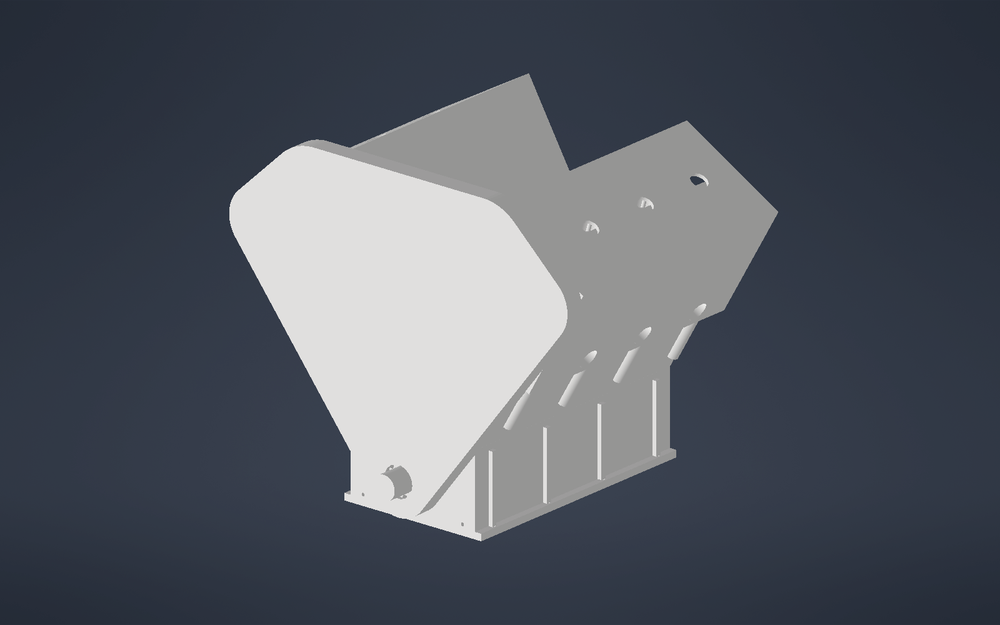
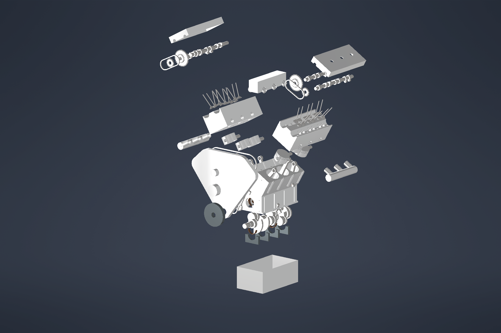
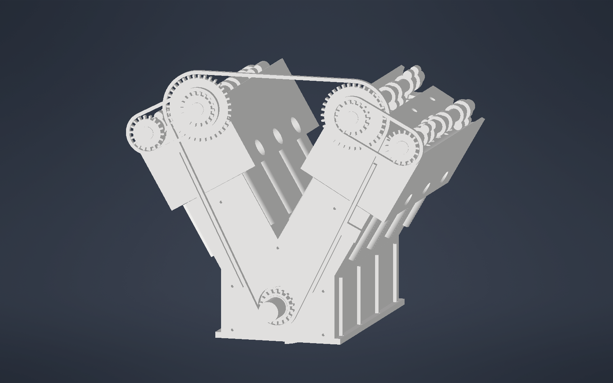

# V6 2GR-FE Engine — Autodesk Inventor Model

A parametric 3D reconstruction of the Toyota **2GR-FE 3.5 L V6** engine, built in Autodesk Inventor. It has 101 parts, a working crank-driven motion assembly, and an exploded view.

## Highlights

- **Fully parametric**: every dimension comes from one master part (`V6_Engine_Master.ipt`) holding 229 parameters.
- **Moving assembly**: a single `Crank_Angle` parameter drives the crankshaft, rods, pistons, and timing drive.
- **Checked design**: there's zero interference across the full engine, plus checks of stroke, phasing, clearances, and valve-to-piston gap.
- **Neutral export**: open `V6_Engine_Assembly.step` in any CAD tool (Fusion 360, SolidWorks, FreeCAD, and others).

## Engine specs used

| Item | Value |
|---|---|
| Layout | 60° V6, DOHC, 24 valves |
| Bore × stroke | 94.0 × 83.0 mm |
| Cylinder pitch | 105.5 mm |
| Firing order | 1-2-3-4-5-6 |
| Crank:cam ratio | 2:1 (18/36 tooth sprockets) |

## Images

| Assembled | Exploded | Valvetrain |
|---|---|---|
|  |  |  |

## Files

| File | What it is |
|---|---|
| `V6_Engine_Assembly.iam` | Main engine assembly (open this first) |
| `V6_Engine_Exploded.iam` / `.ipn` | Exploded view assembly and presentation |
| `V6_Engine_Master.ipt` | Master parameter part that drives all geometry |
| `V6_Block_Assembly.iam`, `V6_Heads_Valvetrain.iam`, `V6_Externals.iam` | Sub-assemblies |
| `*.ipt` | Individual parts (block, crank, rods, pistons, heads, cams, valves, timing, externals) |
| `V6_Engine_Assembly.step` | STEP export for other CAD programs |

## Validation summary

| Check | Result |
|---|---|
| Crank throw 41.5 mm ×6, stroke 83.000 mm on all cylinders, 0/120/240° phasing | PASS |
| Piston-to-bore 0.030 mm, bearing oil clearances | PASS |
| Interference sweep, 12 crank positions | 0 clashes |
| Full engine interference (101 parts) | 0 clashes |
| Valve-to-piston clearance at TDC | 4.1 mm intake / 4.6 mm exhaust |

## Accuracy notes

This is a **reconstruction** made from public specifications, not factory CAD. Core layout dimensions (bore, stroke, V angle, cylinder pitch) are verified. Many details are simplified or assumed, including rod length, cam lobe profiles, head chamber shape, the externals, and materials. Parts with `_SIMPLIFIED` in the name are visual representations.

## How to open

- **Autodesk Inventor** (2024 or newer recommended): open `V6_Engine_Assembly.iam`, then change the `Crank_Angle` parameter to rotate the engine.
- **No Inventor?** Open `V6_Engine_Assembly.step` in Fusion 360, FreeCAD, or SolidWorks.

## Author

Kashyap Nakirikanti
